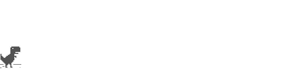
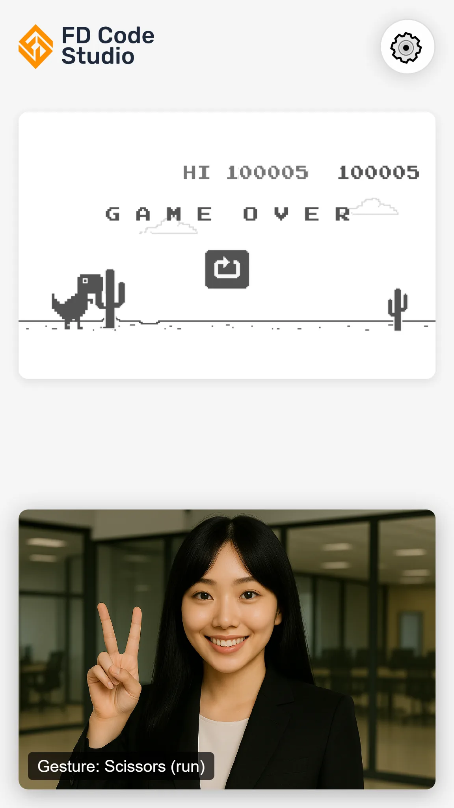

# Gesture Chrome Dino

Control the Chrome Dino runner with real-time hand gestures. Use your webcam to interact with the game, or play with the keyboard.

<p align="center">
  
</p>

<p align="center">
  
</p>

### Mobile gesture demo

<p align="center">
  
</p>

## Features

- Control the Dino runner with real-time hand gestures.
- Use keyboard controls when gesture control is disabled.
- Adjust game speed and jump height.
- Enable autoplay and other game settings.

## Gesture controls

| Hand gesture | Game action |
|---|---|
| Open palm (Paper) | Jump |
| Closed fist (Rock) | Duck |
| V sign (Scissors) | Resume running |

## Hand-tracking implementations

### MediaPipe Hands

MediaPipe Hands is the default implementation, available from the main page (`/`). It uses:

- `@mediapipe/hands` for hand landmark detection.
- `@mediapipe/camera_utils` for webcam frame handling.
- `fingerpose` for gesture classification.

### TensorFlow.js Handpose

An alternative implementation is available at [`legacy/`](./legacy/). Open `/legacy/index.html` to try it. It uses TensorFlow.js Handpose for hand landmark detection and Fingerpose for gesture classification. These libraries are loaded from jsDelivr, so an internet connection is required.

## Getting started

**Requirements:** Node.js 18 or newer and npm.

Install dependencies:

```bash
npm ci
```

Start the development server:

```bash
npm run dev
```

Open the local URL printed by Vite. The main page uses MediaPipe Hands. To try the TensorFlow.js Handpose implementation, open `/legacy/index.html`.

Allow camera access when prompted. Webcam access requires `localhost` or a secure HTTPS origin.

## Production build

Build the project:

```bash
npm run build
```

Preview the production build:

```bash
npm run preview
```

The build includes both the MediaPipe Hands page and the TensorFlow.js Handpose page.

## Project structure

```text
gesture-controlled-dino/
├── css/
│   ├── dino.css
│   └── extension.css
├── img/
│   ├── default_100_percent/
│   ├── default_200_percent/
│   ├── logo.svg
│   ├── mobile-gesture-demo.webp
│   ├── offline-sprite-1x.png
│   ├── offline-sprite-2x.png
│   ├── poster.webp
│   └── screenshot.gif
├── js/
│   ├── dino.js
│   └── extension.js
├── legacy/
│   ├── index.html
│   └── extension.js
├── index.html
├── main.js
├── package.json
├── package-lock.json
└── vite.config.js
```

## Attribution

The Dino runner is based on Chromium's T-Rex runner. See the [wayou/t-rex-runner](https://github.com/wayou/t-rex-runner) project for the upstream game implementation. License terms and copyright notices are provided in [LICENSE](./LICENSE).
